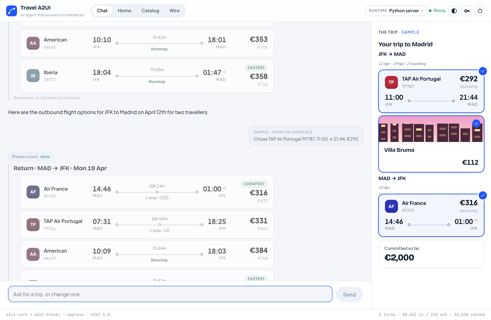
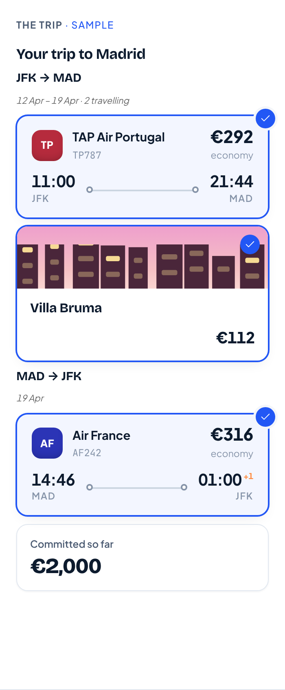
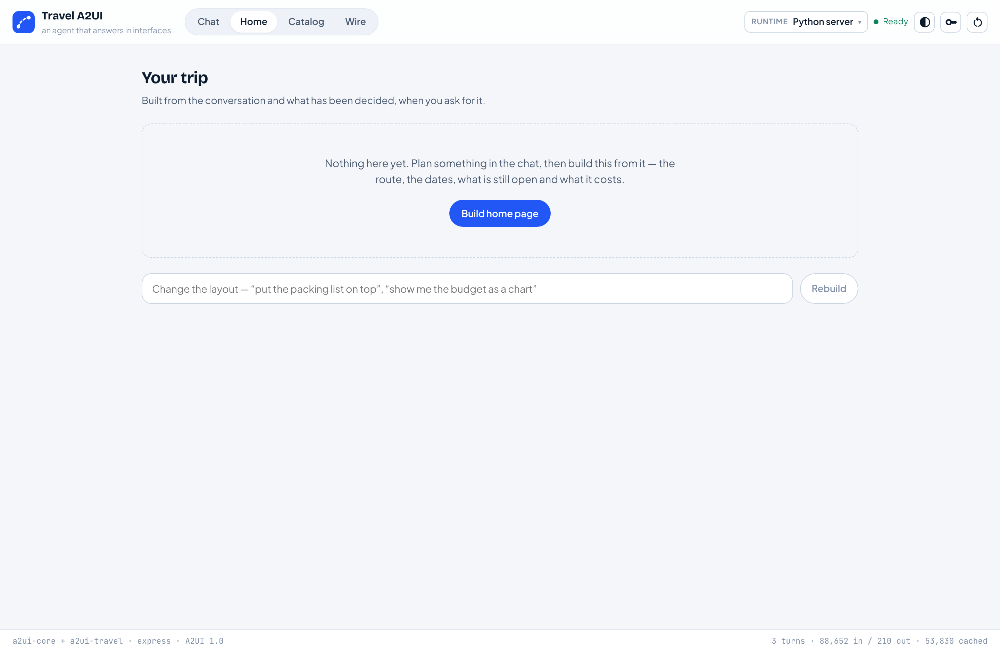
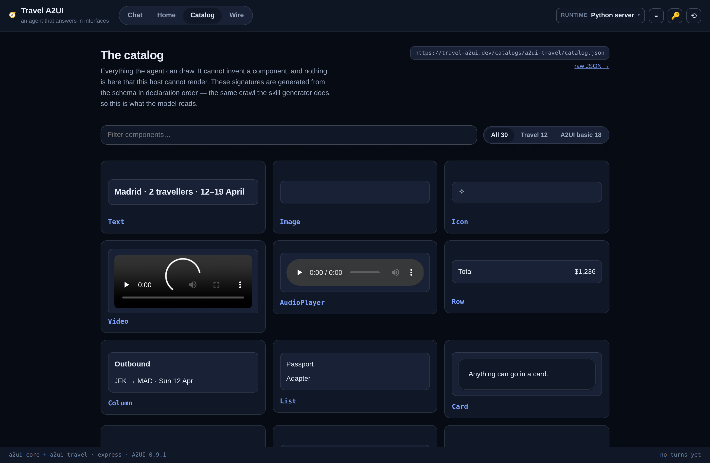
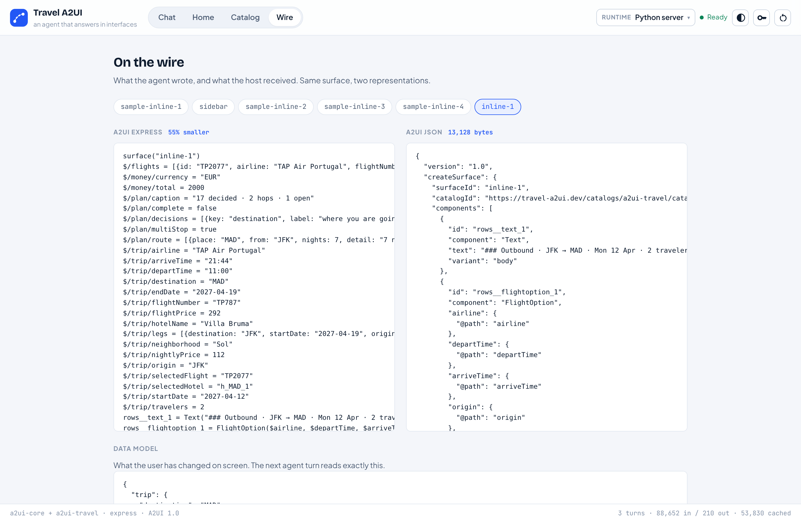

# Travel A2UI

### An agent that answers with an interface instead of a paragraph.

You describe a trip in your own words. It replies with flights you can pick,
dates you can drag and a day plan you can tap through — **built for that answer,
in that moment**, not chosen from screens somebody designed in advance.

<p align="center">
  
</p>

<p align="center">
  <b><a href="https://travel-a2ui-vy7stnte2a-uc.a.run.app">Try it live</a></b> ·
  <b><a href="https://travel-a2ui-vy7stnte2a-uc.a.run.app/docs/quickstart/">Learn A2UI with the quickstart</a></b> ·
  <a href="#run-it-on-your-machine">run it locally</a> ·
  <a href="#deploy-it">deploy in one click</a> ·
  <a href="#build-one-of-your-own">build one</a> ·
  <a href="docs/architecture.md">how it works</a>
</p>

## Not affiliated with Google

This is an independent sample application, not an official Google project, and
it is not affiliated with or endorsed by Google LLC. A2UI — the protocol, the
specification and the catalogs it builds on — is [the A2UI
project's](https://github.com/a2ui-project/a2ui) work; this repository is an app
built on top of it. Treat it as a worked example of building and deploying a
generative-UI application, not as a reference implementation of the protocol.

> **New to A2UI?** The [quickstart](https://travel-a2ui-vy7stnte2a-uc.a.run.app/docs/quickstart/)
> is one line to paste into your coding agent. It sets up the Python server,
> the React client and the Flutter client on your machine, explaining each as
> it starts working, and needs no API key to begin.

---

## The problem, in four lines

Say this out loud: *"I want to go from San Francisco to London and back, for two
of us."* **Three seconds.**

Now do it on a travel site: departure airport, arrival airport, date, date,
travellers, cabin class. Six fields — and you still have not said the things
that actually decide the trip. That you would rather not land at midnight. That
one of you is joining from Chicago. That there is a wedding on the Saturday so
the hotel has to be near the church.

**There is no form that could have asked you all of that** — not because nobody
tried, but because trips do not have a fixed shape. A weekend in Lisbon, a
four-city loop with a different number of people on the last leg, a drive where
you only need a bed: every one is a different set of questions in a different
order. A form has to guess them in advance and show everyone the same ones.

Chat fixes the input and ruins the output. Four flights read out as a paragraph
is a memory test, with nothing to sort and no way to say "that one".

|  | Good at | Bad at |
| --- | --- | --- |
| **A form** | showing you what it understood | asking an open-ended question |
| **Chat** | asking an open-ended question | showing you what it understood |

**You need both halves: open-ended in, structured out.** That is the whole idea.

---

## What you are looking at

In the picture above, the agent did not *pick* that screen. It **built** it, out
of pieces the app already knows how to draw — a flight card, a date picker, a
traveller counter — the way you would build a model out of LEGO. The app ships
the bricks; the agent clicks them together for this answer, this turn.

```
   you say something, however you like
                  │
                  ▼
   the agent works out what you meant, and what is still open
                  │
                  ▼
   it writes a short description of an interface —
   which components, bound to which data
                  │
                  ▼
   your device draws it, using components it already has
                  │
                  ▼
   you press, drag or pick — and that is your next turn
                  │
                  └──────────────► back to the top
```

Three things follow, and they are the reason this is worth building:

**You can see what it understood.** You said "two of us, first week of June"; it
draws a counter showing **2** and a range showing **1–7 June**. Wrong? Drag it
now, instead of finding out three turns later when it prices the wrong trip.

**You answer by pointing.** Four flights arrive as four cards. Tap one. No
flight numbers, no "the second one — no, sorry, the third".

**It is still a conversation.** The text box never went away, so *"actually, can
we leave a day later?"* works at any point.

And because the agent sends a *description* rather than pixels, the same answer
draws in a web app or in a Flutter app. Neither of them knows anything about
travel.

---

## Try it in two minutes

**1. Get a Gemini API key — free.** Go to
[aistudio.google.com/apikey](https://aistudio.google.com/apikey), sign in with a
Google account, and press **Create API key**. The free tier is enough for this.

**2. Open the app** and paste it when asked:

> ### **[travel-a2ui-vy7stnte2a-uc.a.run.app](https://travel-a2ui-vy7stnte2a-uc.a.run.app)**

Or skip the form by putting the key in the URL fragment, which never leaves your
browser:

```
https://travel-a2ui-vy7stnte2a-uc.a.run.app/#key=AIza...
```

The key is held in *your* browser and sent with each request. It is never stored
on the server. ([Why `#key=` and not `?key=`.](#the-key))

**3. Say something.** These all work:

- `Six days in Madrid in April, two of us, around $2,500 all in`
- `SFO to Chicago for two nights then New York for four, then home — a friend joins me in Chicago`
- `Plan three days in Tokyo — first visit, we like walking`

**No key, no signup:** the **Catalog** tab draws every component the agent can
use, with the real renderer. It is the fastest way to see A2UI render with
nothing else in the path.

**Other ways in:** the same agent, the same catalog and the same surfaces drawn
by the [Flutter client](https://travel-a2ui-vy7stnte2a-uc.a.run.app/flutter) —
a second renderer of the same messages, which is the clearest demonstration that
the agent is describing an interface rather than emitting one.

<p align="center">
  
</p>

<p align="center">
  <sub>The record of what you have decided, each row re-openable.</sub>
</p>

---

## Run it on your machine

One Python server and two clients. You need `git`, Python 3.11+, Node 20+, and
Flutter 3.47+ for the Flutter client.

**1. The Python server**, the agent:

```bash
git clone https://github.com/vpm238/travel-a2ui && cd travel-a2ui
python3 -m venv .venv && source .venv/bin/activate
pip install -e apps/server
uvicorn travel_a2ui.doors.http:app --port 8080 --app-dir apps/server/src
```

**2. The React client** (web), in a second terminal:

```bash
npm install && npm run build
```

Open http://127.0.0.1:8080.

**3. The Flutter client** (mobile):

```bash
cd renderers/flutter && flutter pub get && flutter build web --base-href=/flutter/
```

Open http://127.0.0.1:8080/flutter/.

The server serves each client as soon as it is built, without a restart.
React opens on a sample trip with no key; to talk to the agent, and for
Flutter, paste a Gemini key into the app when it asks, or start the server
with `GEMINI_API_KEY` set. `npm run setup` does steps 1 and 2 in one go, and also
regenerates the generated files and runs the tests.

---

## Build one of your own

Start from [Run it on your machine](#run-it-on-your-machine).

**Nothing here is coupled to travel except the names.** The fastest way to see
that is to replace them:

| To change… | Edit | And then |
| --- | --- | --- |
| what the agent can draw | `scripts/build_catalog.py` (it writes `catalogs/a2ui-travel/catalog.json`) | write the React and Flutter views, register them |
| what it can look up | `data/tools.json` | one `switch` in `brain/tools/run.py` |
| how it decides what is next | `prompts/flow.md` | nothing — it is markdown |
| what the model is told about components | *nothing* | `npm run generate` writes it from the catalog |

Two rules worth stealing whatever you build. **Anything that must not vary
belongs in the host, not the prompt** — a rule in a prompt is a request to a
model; a rule in the host is a guarantee. And **anything derivable should be
derived**: a night count written by the model is right in the screenshot and
wrong the moment a date moves.

[**docs/architecture.md**](docs/architecture.md) is the long version, decision by
decision.

---

## Why this matters beyond travel

Travel is the example. The pattern underneath it is not about travel at all.

**It gives people back their evenings.** Planning a trip for four people across
three cities is currently a spreadsheet, a group chat, eleven browser tabs, and
two hours. Most of those two hours are not decisions — they are re-entering the
same dates into a fourth website. Generative UI collapses the re-entering and
leaves the deciding, which is the part you actually wanted to do.

**It makes plans people can share.** A trip that lives as a structured plan —
rather than as scattered messages and screenshots — is a thing you can send to
the person coming with you. They can see what is settled, what is still open,
and what it costs. Half of what makes group travel exhausting is that nobody has
the same picture of the plan; this gives everyone the same picture.

**It reaches people a form never could.** Forms assume you know the vocabulary:
airport codes, cabin classes, "flexible dates ±3". Speaking plainly is something
everyone can do — including in their own language, including out loud, including
if typing is hard for them. Then the interface does the precise part, so nobody
has to be precise in order to be understood. That is a genuine widening of who
gets to use software well.

**And it generalises.** Anything where the request is open-ended and the answer
is a decision has this shape: choosing a health plan, filing something with a
government, picking a mortgage, booking care for a parent. All of those are
badly served by forms for the same reason travel is — the situations vary more
than any form can anticipate — and all of them are decisions people currently
make from paragraphs of text they cannot compare.

The prize is not "a prettier chatbot". It is software that adapts to the person
rather than making the person adapt to the software.

---

## How this repository solves it

Now the real version of the idea, still in plain language.

**The agent writes the interface; it does not send pictures.** When the agent
decides you should see four flights, it does not produce HTML or an image. It
writes a short description of a UI tree — which components, in what order, bound
to which data. That description travels over the network and *your* device draws
it, using components your device already has.

That one decision is what makes everything else possible: the same answer can be
drawn by a web page or a phone app, because each of them knows how to draw the
bricks and neither needs to know anything about travel.

**The language it writes is A2UI.** [A2UI](https://a2ui.org) is an open protocol
for exactly this — agents that reply with interfaces. It defines the message
shapes ("create a surface", "here are its components", "here is its data") and
leaves the components themselves to a *catalog* the app supplies. Our catalog is
`catalogs/a2ui-travel/catalog.json`: 33 components — the SDK's v1.0 basic set
plus fifteen travel ones, including `FlightOption`, `HotelCard`,
`DateRangePicker` and `ItineraryDay`.

**It writes them in a shorthand called Express.** Raw A2UI is JSON, which is
verbose to generate. A2UI Express is a compact notation for the same tree:

```
head = Text("### Flights to London")
row  = FlightOption($airline, $departTime, $arriveTime, $origin, $destination,
                    $price, Event("select_flight", {id: $id}))
list = List(_template($/flights, row))
root = Column([head, list])
```

Roughly half the size of the equivalent JSON, and — this is the part that
matters for how it *feels* — **a half-written Express program is still a valid
program.** So the interface can be compiled and painted while the model is still
typing the rest of it, instead of appearing all at once at the end.

**The screen fills in before the data arrives.** When the agent decides to search
for flights, the *shape* of the answer is already known: a list of fares, each
with an airline, a time, a price. So the agent draws that list first, bound to
`$/flights`, and then calls the search; when the rows come back the host puts
them into the surface's data model and the cards fill in. You watch an interface
fill in rather than a spinner spin.

**Nothing is invented.** The tools that fetch travel data cannot return an empty
success. If there are no flights under your price cap, the tool widens the search
and *says which filter it dropped*. If it has never heard of your destination, it
says so and offers ones it knows, rather than inventing an airport code. Every
price on screen carries a note saying where the number came from. See
[Notes on the parts that are simulated](#notes-on-the-parts-that-are-simulated).

### The model draws; the host supplies data

**Every surface is composed by the model.** The server never draws one of its
own, never rewrites what the model wrote, and never patches a surface on the
way out. Its part is data, and checking.

**Macros are templates, not screens.** The catalog adds six macros —
`Flights()`, `Stays()`, `Highlights()`, `Itinerary()`, `Trip()` and `Booked()` — and each is
a template over a data root the host publishes, expanded into plain catalog
components by the SDK's `MacroExpander` before anything is sent. The model
decides whether to use one, where it goes and what surrounds it:

```
surface("inline-2")
head = Text("### Outbound · JFK → MAD · Sun 12 Apr")
fares = Flights()
root = Column([head, fares])
```

**The host fills what a surface binds, and only that.** The roots are the
record (`/trip`, and views of it: `/plan`, `/panel`, `/booked`, `/days`,
`/money`, `/places`) and the rows of the latest lookups (`/flights`, `/hotels`,
`/highlights`, and each hop's own at `/fares/N` and `/rooms/N`). A card this
turn draws that binds `$/flights` gets the fares, as `updateDataModel`, when the
search returns; a surface that binds nothing gets nothing; a card from an
earlier turn keeps the rows it was drawn with. The full table is [`prompts/data.md`](prompts/data.md), which is also
what the model is told.

**Everything is checked against a mirror of the renderer before it is sent.**
The server keeps a `RendererState` per conversation — the SDK's own model of
what a renderer holds (`brain/ui.py`, `Canvas`) — and every message is applied
to it first. A block the SDK refuses is never sent: the reason goes back to the
model, once, and it draws again (a `retry` event). A surface that cannot be
answered as drawn — a date asked for in a text box, a form with no
`sendDataModel` — is reported the same way (`brain/controls.py`). The model
corrects its own work; the host does not.

**The panel is drawn once and kept current by data.** After the first turn that
settles a destination, if the client holds no panel, a short panel turn asks the
model for one, and it draws `Trip()`. From then on it moves by `updateDataModel`
alone: pressing a fare reaches the panel in one data update, not in another
model turn, and a panel is never redrawn or replayed to catch up.

**The renderer answers in A2UI too.** A press is an A2UI v1.0 action message, a
surface the renderer could not show is an A2UI error message, and every request
carries the renderer's capabilities (`a2uiRendererCapabilities`) and the data
model of every surface that asks to send one (`a2uiRendererDataModel`). The
server validates each with the SDK's v1.0 models, and reads what the traveller
changed by comparing that data model with its mirror of what it sent.
[`docs/transport.md`](docs/transport.md) has the wire format for both doors.

### What decides the next screen

This is the part most worth stealing, and the part that took longest to get
right.

The obvious way to build this is a state machine: seven stages, a `next_step()`
that looks at the trip and returns the one after it, and a surface per stage. It
works exactly until somebody says *"a friend
joins us in Chicago and comes back with us"*. Now there are three hops with two
different party sizes, one of them needs a hotel and one does not, and there is
no ordering of seven stages that describes it. Every trip that is not the common
one becomes a special case, and a state machine full of special cases is a form
with extra steps.

So there is no state machine. There is a loop, and the agent runs it:

> **an input arrives → it is a decision → the record updates → the agent works
> out what is next from what is now known → it draws the UI for that next set of
> decisions.**

Three consequences, and they are what make it hold together:

**Everything is a decision, whatever shape it arrives in.** Typing "three of us
on the way back" is one. Tapping a fare out of four is one — *choosing one of
many is a decision*, not a step towards one. Ticking "no bed needed here" is one.
Each lands on the trip record the same way, and the panel on the right moves
with it, as data, without costing a turn.

**What is open decides what is drawn.** The trip is not a form with a progress
bar; it is a record with open questions in it, and the interface is the
projection of those questions. `journey()` in `brain/trip/route.py` walks the route and
reports, hop by hop, what that hop still wants: a date, a party size, a ticket, a
place to stay *only if somebody sleeps there*, something to do *only if they stay
more than a night*. Four hops with three parties and two stays is not a special
case — it is the same walk, over a longer route.

**The judgement is prompted; the vocabulary is generated.** Two things sit in
`prompts/`: [`flow.md`](prompts/flow.md), which is the loop above and a table of
gap → step → tool → components, and [`journey.md`](prompts/journey.md), which is
how a route is read ("the journey is hops, and every hop is its own ticket" —
including the hop home, so nobody is left in Madrid). Neither one names a step
number. What components exist and how to write
them is *generated* from the catalog and never authored. Judgement in prose,
vocabulary from a schema, and nothing in between hard-coding an order.

Two things are fixed, deliberately, and only two: the trip's field names, so the
panel, the tools and the prompt cannot disagree about what has been decided; and
that a decision is asked for in a control its answer cannot be wrong in — a date
in a date picker, a party size in a counter. Everything else — how many legs, how
many days, which surface asks what — is the agent's to shape for the trip in
front of it.

And because none of that is deterministic, it is measured rather than asserted.
[`tools/eval/flow.py`](tools/eval/flow.py) plays whole conversations — the words,
then the presses, resolved through the surface's own bindings exactly as a
renderer would send them — and scores the *run*: did the route come home, was a
question re-asked after it was answered, did any turn draw nothing. A run in
which every turn is individually fine can still strand someone abroad, and only
a harness that plays journeys sees it.

### The shape of the system

```
            ┌──────────────┐   ┌──────────────┐
            │  React web   │   │ Flutter web  │
            │    client    │   │    client    │
            └──────┬───────┘   └──────┬───────┘
                   │                  │
                   └────────┬─────────┘
                             │   A2UI messages — the same ones,
                             │   whichever is on the other end
                    ┌────────┴─────────┐
                    │   Python server  │
                    │                  │
                    │  · the agent     │  ← decides what to say and draw
                    │  · the skill     │  ← teaches the model the catalog
                    │  · the canvas    │  ← a mirror of each renderer
                    │  · the tools     │  ← flights, hotels, weather, costs
                    │  · the trip      │  ← what has actually been decided
                    └────────┬─────────┘
                             │
                  ┌──────────┴──────────┐
                  │  Gemini             │
                  │  · Interactions API │  typed conversation
                  │  · Live API         │  spoken conversation
                  └─────────────────────┘
```

Three ways to see it, two ways to talk to it, one model that composes the
interface and one server that checks it and fills it with data. The clients contain no travel logic at all — a client knows how to
draw a `FlightOption` and nothing about what a trip is.

**You can switch the runtime and watch the same components come back.** The app
offers two agent frameworks as an explicit choice: the Interactions API (typed)
and the Live API (spoken, with a microphone). They are genuinely different
runtimes, sharing no code path. That they produce the same surfaces is the
clearest available evidence that the interface layer is independent of the
engine behind it.

---

## Where to read next

Start wherever matches what you want:

| If you want to… | Read |
| --- | --- |
| Type the demo and see it work | **[docs/demo-script.md](docs/demo-script.md)** — exact things to type, and what should come back |
| See every component, drawn | **[docs/catalog.md](docs/catalog.md)** — each one pictured beside the line of Express that made it |
| Understand the flows and the edge cases | **[docs/user-flows.md](docs/user-flows.md)** — including which rules are enforced in code rather than asked of the model |
| Understand how it is built | **[docs/architecture.md](docs/architecture.md)** — the long version, decision by decision |
| Write another client | **[docs/transport.md](docs/transport.md)** — what goes over the wire, both ways |
| Deploy it | **[docs/deploying.md](docs/deploying.md)** — Cloud Run, and the one setting not to change |

---
## Running it, in detail

[Run it on your machine](#run-it-on-your-machine) is the short version. This
is everything around it.

One server. It is Python, it is two packages — `brain/` and `doors/` — and it
serves the API and the built clients from one origin.

### Developing against it

Two terminals, so a change to a component is visible without a rebuild:

```bash
# terminal 1 — the API, restarting on a change
uvicorn travel_a2ui.doors.http:app --port 8080 --app-dir apps/server/src --reload

# terminal 2 — the React client, with hot reload
npm run dev:web                      # http://127.0.0.1:5173
```

Open `http://127.0.0.1:5173` and paste a Gemini API key when asked. Vite
passes `/api`, the voice socket included, to the server on 8080. Once the
client is built (`npm run build`), the server serves it too and one port is
enough:

```
http://127.0.0.1:8080
```

### The key

Paste it when asked, or skip the form entirely:

```
http://127.0.0.1:8080/#key=AIza...
```

The key is taken out of the URL and the address bar is rewritten before anything
else reads it, then kept in this browser and sent with each request. It is never
stored on the server. `#key=` is the form to use: a fragment never leaves the
browser. `?key=` also works, because people paste it, but the server saw it and
the app says so once — treat such a key as logged. (Get one at
[aistudio.google.com/apikey](https://aistudio.google.com/apikey).)

The **Catalog** tab works with no key at all — every component the agent can
draw, rendered by the real renderer, so it is the fastest way to see A2UI render
with nothing else in the path.

### Deploy it

[](https://deploy.cloud.run/?git_repo=https://github.com/vpm238/travel-a2ui)

One click deploys it to Cloud Run in your own Google Cloud project: the server
and both clients, on one URL. The button opens Cloud Shell, builds the
`Dockerfile` (about ten minutes the first time) and asks only for a project and
a region; its settings are in [`app.json`](app.json). No key is stored on the
service, because each visitor pastes their own.

**[docs/deploying.md](docs/deploying.md)** has the one-command version
(`gcloud run deploy --source .`), a deploy on every push to `main`, and the
one setting not to change: `--max-instances 1`, because conversations live in
the server's memory.

One thing the image does that is worth copying: it ends with

```dockerfile
RUN python -c "import travel_a2ui.doors.http"
```

Everything above that line can succeed and still produce a container that cannot
start — a module reading a data file nobody copied, a static mount pointing at a
directory that is not there. Cloud Run reports all of it identically ("failed to
start and listen on the port"), several minutes after the build went green, in a
log the deploy does not show you. Importing the app at build time turns that into
a build failure that names the file.

---

## Make it something else

Nothing here is coupled to travel except the names, and the fastest way to see
that is to replace them. In rough order of effort:

**Swap the catalog.** `scripts/build_catalog.py` builds the vocabulary — the
SDK's v1.0 basic catalog plus one JSON Schema entry per travel component — and
writes `catalogs/a2ui-travel/catalog.json`. Add `InvoiceLine` beside
`FlightOption` there, write its view in
`renderers/react/src/components/travel.tsx` (and
`renderers/flutter/lib/components.dart`), add it to `TRAVEL_VIEWS`, and the
model can draw invoices. A client that cannot draw a component the catalog
offers refuses the catalog at startup, by name.
[`docs/catalog.md`](docs/catalog.md) is generated from that file — every
component pictured as the renderer actually draws it, with the one line of
Express that produced it — so it is also the shape to copy.

**Narrow what the model sees.** `catalogs/a2ui-travel/agent-components.json` is
the allow-list, applied in `brain/catalog.py` with the SDK's
`ComponentPruningTransformer` and `FunctionPruningTransformer`. Renderers keep
their full registry; only what the *model* is offered is pruned, so trimming it
costs a client nothing and saves tokens on every turn.

**Add a macro.** `brain/macros.py` holds the five templates. A macro binds a
data root and nothing else; if it needs data the host does not publish yet, add
the root in `brain/data.py` and a line to `prompts/data.md`.

**Change the worked examples.** `catalogs/a2ui-travel/examples/*.json` are A2UI
JSON, one turn per file — the wire format, written once. The SDK decompiles
them into Express for the prompt and the skills, and
`apps/server/tests/test_examples.py` checks each against the catalog.

**Regenerate the skill.** `npm run generate` runs the official A2UI
`SkillGenerator` over the same processor the server parses the model with, and
writes `skills/`. You do not write the component documentation the model reads
— the catalog is the source, and a component you add documents itself.

**Change the tools.** `data/tools.json` is one array of
`{name, description, input_schema}`, and `brain/tools/run.py` is one `switch` over
it. The contracts are provider-neutral on purpose: `gemini_tools()` is a short
adapter over it, so a second provider costs a few lines rather than a second
copy of the schemas.

**Then the parts you should not need to touch**: the SDK processor, the renderer
SDKs, the canvas mirror and the data roots. Those are the A2UI layer, and they do
not know what a trip is.

Two rules are worth stealing whatever you build. Anything that must not vary
belongs in the host, not the prompt — a rule in a prompt is a request to a model,
and a rule in the host is a guarantee. And anything derivable should be derived:
a night count written by the model is correct in the screenshot and wrong the
moment a date moves.

---

## The three flows

Not three screens — three *placements*, each answering a different question, and
each composing the same data differently. They are properties of where an answer
goes, not of this codebase, which is why they survive the trip into a second
renderer unchanged.

### 1 · Inline — attached to the message being answered

The user asked something; this is the answer, drawn under it.

- **Scope**: one job. Three flights, not nine. A date picker, not a settings
  panel.
- **Lifetime**: permanent and per-turn. Surface `inline-3` stays live and
  clickable after the conversation moves past it, so you can go back and change
  your mind.
- **Actions continue the conversation.** Picking a flight is the user's next
  turn, phrased in the interface instead of in prose.
- **User flow**: *"Find me a flight to Madrid"* → three `FlightOption`s → tap one
  → the agent saves it and asks about hotels.

### 2 · The panel — what is settled

Persistent, beside the conversation. **Read-only**, and that is the design
rather than a limitation.

- **Scope**: decisions, not controls. The route stop by stop, the flight and
  stay chosen, the dates, what it comes to, how far through the plan you are.
- **Lifetime**: singular, drawn once. The model composes it the first time the
  trip has a destination (`Trip()`, bound to `$/panel` and `$/trip`); after that
  the host keeps it current with `updateDataModel` and no model in the path, so
  changing the route on an inline card updates it immediately. It is never
  redrawn or replayed to catch up.
- **One interaction: Change.** It releases that decision — and whatever was
  decided because of it — and the agent re-opens it *inline*, pre-filled. Two
  places that can edit one value is how a conversation loses track of its own
  history, so the conversation is where you decide and this is the record.
- **User flow**: press Change on the flight; it disappears from the panel and
  comes back as a picker in the conversation, with the fare you had highlighted.

### 3 · Home — where the trip stands today

Read first, and not in reply to anything.

- **Scope**: the number that matters most right now, then anything needing a
  decision, then context — weather, the map, the next day.
- **Lifetime**: singular, composed when you ask for it from the Home tab — a
  dashboard summarises a trip, so it waits until there is one.
- **Generative layout**: not a fixed dashboard. Ask it to "put the packing list
  on top" or "show the budget as a meter" and the layout changes, because the
  layout is the model's output.
- **User flow**: open the app in the morning → *17 days to Madrid*, budget used,
  the one unbooked thing → tap it and land back in the conversation.

| | Rendered in the app by | Composed by |
|---|---|---|
| Inline | `apps/web/src/components/Chat.tsx` | the agent, per answer — keyed `inline-3`, so the transcript is a list of things that were asked |
| Sidebar | `apps/web/src/components/Sidebar.tsx` | the agent, once — then kept current by data |
| Home | `apps/web/src/components/Home.tsx` | the agent, singular, when asked for |

**They are placements, not screens.** A surface that stays put and moves with
the data behaves like a panel wherever it lands, and one keyed to the message it answers behaves
like a card — which is why the Flutter client gets the same three without being
told what any of them mean.

<p align="center">
  
</p>

Two more tabs earn their place. **Catalog** shows every component the agent can
draw, with the exact signatures the model is given — so "what is it allowed to
use" is one click away rather than a JSON schema away.

<p align="center">
  
</p>

**Wire** shows any live surface in both representations — the A2UI JSON the
renderer holds, and the same messages as Express, decompiled by the SDK on the
server (`POST /api/express`) — because "what did the model actually emit"
is the first question anyone asks about generative UI.

<p align="center">
  
</p>

---

## Talking to it

Choosing **Gemini Live** as the agent framework puts a microphone in the
composer. The session is relayed through the server rather than opened straight
from the browser, and that choice is the whole architecture in miniature: the
browser *could* open the socket itself, and then every client would need the
catalog, the compiler, the tools and the trip. Instead it sends microphone bytes
and receives audio plus A2UI — exactly what the Flutter client would send and
receive.

Speech is a property of the *backend*, not of the client. Every client can listen
if the Live framework is selected; none of them contains any audio logic beyond a
microphone and a speaker.

**It is not a call.** A call has a beginning and an end you press a button for,
and the screen is somewhere you go. Here the screen is already in front of you
the entire time — talking is simply one way to use it, in the way the assistant
on your phone is. So there is a microphone that opens and closes, over a session
that outlives both, and stopping talking ends a *sentence*, not the session: the
answer still arrives.

The model draws by calling one tool, `render_a2ui_express`, with an Express
block. That is the only route, not a shortcut: a spoken reply *is* audio, so
Express written into one would be read out rather than drawn. The block goes
through the same SDK processor and the same mirror of the renderer as a typed
turn; a block with no `surface(...)` line becomes a new card (`voice-1`,
`voice-2`, …). A live turn:

```
TOOL    save_trip {travelers: 2, startDate: 2027-04-12, …}
TOOL    render_a2ui_express  → voice-1: Text, Flights()
TOOL    search_flights {origin: JFK, destination: MAD, …}  → rows into $/flights
agent:  "…the cheapest is Delta for about 352, the fastest is TAP
         for around 362 nonstop."
```

It rounded the numbers, named two of four options, and left the rest to the
screen — which is what voice and a screen together are *for*. The model is
handed a summary of the search, not the rows; the rows go to the card as data.
A press during the call is the same A2UI v1.0 action a typed turn sends, in a
`press` frame: it is recorded on the trip first and then told to the model. The
relay shares the session with the typed conversation, so saying "make it three
of us" moves the same panel.

Switching framework reloads the page and starts a fresh conversation with an
empty trip. Two APIs with two conversation histories is difference enough
without also deciding which parts of a half-made trip survive the crossing.

Four things cost an evening each and are worth knowing if you build one:

- **The model answers on voice activity detection, and VAD decides you stopped
  talking by *hearing* the silence after you.** A browser that stops sending the
  instant you stop speaking never sends that silence, so the model sits waiting
  for audio that is not coming. There is a frame for saying so —
  `send_realtime_input(audio_stream_end=True)` — and sending it is the difference
  between a reply and nothing at all. The client sends `audio_end` for it.
- **Inbound frames arrive as a `Blob`**, so `TextDecoder().decode` on one produces
  rubbish and every frame vanishes without throwing.
- **The Live API rejects an entire `setup`** if a function declaration carries
  `additionalProperties`, `$schema` or `strict` — which ordinary Gemini tool
  schemas all do. One bad key and nothing connects.
- **There is no agent object to point at.** Interactions has one; Live does not,
  so the first spoken turn has to do a handshake that binds the catalog, the
  skill and the tools. The tap on the microphone does it — a microphone you
  cannot press is not a microphone — and `ready` is sent only once the Live API
  has accepted it, so a bad key never looks bound.

---

## How it fits together

**One brain, two doors, two renderers.** That sentence is the architecture, and
the directories are named after it.

```
                         ┌────────────────────────────────────────────┐
data/          ─────────►│  brain/                                    │
catalogs/      ─────────►│    catalog  the catalog, and the SDK       │
prompts/*.md   ─────────►│             processor that reads the model │
                         │    ui       the canvas: a mirror of each   │
                         │             renderer, and the data it is   │
                         │             owed                           │
                         │    skills   what the agent is told         │
                         │    tools    what it can call               │
                         │    trip     what it remembers              │
                         └────────────────────────────────────────────┘
                                          │
                        ┌─────────────────┴─────────────────┐
                        ▼                                   ▼
               the typed door                      the voice door
               doors/http.py + interactions/       doors/live.py
               Gemini Interactions API, SSE        Gemini Live API, WebSocket
                        │                                   │
                        └─────────────────┬─────────────────┘
                                          ▼
                       A2UI v1.0 messages, both ways (docs/transport.md)
                                          │
                          ┌───────────────┴───────────────┐
                          ▼                               ▼
                  renderers/react                  renderers/flutter
                  React                            Flutter
```

The **brain** holds every decision worth making: the catalog and the processor
that reads the model, the canvas every message is checked against, the skills,
the tools and the trip record. It has no idea which door a request came through,
and nothing in it imports a transport.

The **doors** hold transport and nothing else. The typed door is `http.py` and
the turn loop in `interactions/`; the voice door is `live.py`, the same brain
over a bidirectional audio socket; `http.py` also serves the clients. When a door
starts wanting to know what a trip is, that knowledge belongs in the brain and
the door should be asking for it.

The **renderers** draw A2UI, send actions back, and wait for the next A2UI, and
they are the official SDKs: `@a2ui/react` over `@a2ui/web_core` in the browser,
`a2ui_flutter` over `a2ui_core` in Flutter. Each SDK holds the surfaces, resolves
every binding and function call, and draws the basic components. What this
repository adds is a catalog: fifteen travel views and two functions
(`calcNights`, `equals`), the same on both clients. Neither holds travel logic or
any opinion about what a trip is.

That constraint is the one to defend when changing anything here: **maximise
server-side agency, minimise client-side logic, so one agent drives thin,
generic clients on Web, iOS, Android and Flutter.** A feature that needs new
client code to work is a feature that has left the protocol.

Everything the model is given is a file on disk rather than a string in code,
and that is deliberate. The tool descriptions live in `data/tools.json`, the
role and the surface briefs in `prompts/*.md`. Both doors read the same files,
so a change to what the agent is told is reviewable as a diff — and there is no
second, hand-typed copy to drift. A retyped prompt is a different agent, and the
difference does not look like a bug from either side.

Four things are generated and checked in, so a stale one fails CI rather than
shipping quietly:

| Generated | From | Regenerate |
|---|---|---|
| `catalogs/a2ui-travel/catalog.json` | the SDK's v1.0 basic catalog, `derive`d with the travel components | `python3 scripts/build_catalog.py` |
| `skills/**/SKILL.md` | the server's processor, via the SDK's `SkillGenerator` | `python3 scripts/build_skills.py` |
| `apps/web/src/generated/catalog-reference.json` | the catalog, for the Catalog tab | `python3 scripts/build_catalog_reference.py` |
| `renderers/flutter/test/fixtures/flights.json` | the server's own pipeline, for the Flutter tests | `python3 scripts/build_fixtures.py` |

`npm run generate` does all four; `npm run check` fails if any is stale.

---

## The skills

A **skill** is the document that teaches the model the catalog: what components
exist, what each one takes, and how to write them. It is generated by the A2UI
SDK's own `SkillGenerator` rather than written by hand, from the very processor
the server parses the model with — `SkillGenerator(PROCESSOR.format)`, whose
format already holds the pruned catalog, the macros and the worked examples. So
the prompt snippet the model is given (`PROCESSOR.prompt_snippet`), the parser
that reads its answer and the skills another agent loads are one configuration.
A component added to the catalog is one the model knows about on the next build,
and `apps/server/tests/test_skills.py` fails if the skills and what the model is
taught ever differ. Nothing is edited after generation.

The design principle it implements is worth stating on its own:

> A skill's `name` and `description` are what an agent sees during discovery, and
> all it sees before deciding whether to load the thing. So they describe a
> **capability** — "generates interactive user interface components" — and never
> an implementation. Which inference format, which protocol version, which schema
> file: none of that helps a model route a request, and all of it crowds out the
> words that do. Those details go in `metadata`, where SDKs and humans can read
> them and the model pays nothing for them.

```
skills/
└── express-modular/
    ├── a2ui-core/SKILL.md                          the notation, which never varies
    └── a2ui-travel/SKILL.md                        this catalog's components
```

One shape ships, `express-modular`: a core skill for the notation and one per
catalog. It was chosen by measurement, four asks with three samples each,
against the same catalog as a single Express skill and the same interfaces as
raw A2UI JSON:

| Variant | drew the right component | compiled first time |
|---|---|---|
| `express-modular` | 11/12 | 10/12 |
| `express-monolithic` | 10/12 | 9/12 |
| `direct-json-monolithic` | 3/12 | 3/12 |

Direct JSON drew nothing at all on three of the four asks, and took longest
doing it. `VARIANT` in `scripts/build_skills.py` names the shape; re-run the
comparison whenever a new model makes the question live again.

The modular shape is also what scales past one domain: an agent working on
travel loads `a2ui-core` + `a2ui-travel` and never pays for the charting
catalog.

**These generated skills are half the contract.** They say what components exist
and how to emit them. What the agent does *when* — which step comes next, how a
route with three hops and two parties is shaped, which control a decision is
asked in — is authored markdown in `prompts/`, because it is judgement rather
than a catalog.

No skill ships a script. They are instructions, and a test asserts that each
directory contains nothing but `SKILL.md`.

---

## A2UI Express

The notation the agent writes:

```
surface("inline-2")
heading = Text("### Outbound · JFK → MAD · Sun 12 Apr")
f1 = FlightOption("Iberia", "18:40", "08:15 +1", "JFK", "MAD", "$412",
                  Event("select_flight", {id: "IB6250"}),
                  duration="7h 35m", stops="Nonstop", badge="Cheapest")
root = Column([heading, f1])
```

Three properties make it worth a compiler:

- **It is roughly half the size of the equivalent JSON.** The Wire tab prints
  the exact ratio for whatever is on screen.
- **A partial program is still a program.** `root = Column([heading, f1])` is
  valid the moment those lines exist, so the surface paints while the model is
  still typing. Truncated JSON is a parse error.
- **Variables are ids.** The model does not have to invent an id for every
  nested component and then remember it.

The server reads it with the official A2UI Python SDK (`a2ui-agent-sdk`): an
`A2uiRequestProcessor` (`brain/catalog.py`) whose `open_stream()` yields prose
and A2UI as the model types, healing a half-written string and holding a
component until its value arrives. Macros are expanded by the SDK's
`MacroExpander`, and every message is applied to a `RendererState` before it is
sent. The Wire view's Express is the same processor's decompiler, served at
`POST /api/express`. Nothing here reimplements the parser, the validator or the
decompiler.

## Layout

```
travel-a2ui/
├── data/                       the facts: destinations, airlines, lodging, tool contracts
├── prompts/                    what the agent is told: its role, and each surface's brief
├── catalogs/
│   └── a2ui-travel/            catalog.json (generated), agent-components.json, examples/*.json
├── apps/
│   ├── server/                 ★ the whole backend: brain/ and doors/
│   └── web/                    React client: the flows, /catalog, and the wire inspector
├── renderers/
│   ├── react/                  the travel catalog for @a2ui/react: 14 views, 2 functions, the design
│   └── flutter/                the same catalog for a2ui_flutter
├── tools/
│   ├── sample/                 records the sample trip a first visit opens on
│   ├── e2e/                    a whole browser turn against a scripted model
│   ├── eval/                   the flows graded against a real model, mechanically
│   ├── validate/               whole journeys and a voice call, against a real model
│   └── screenshots/            the README's pictures and docs/catalog.md, reproducibly
├── scripts/                    setup, generation, and repo extraction
├── docs/
│   ├── catalog.md              every component, pictured — generated, never written
│   ├── user-flows.md           the flows, and which rules are code rather than prompt
│   ├── demo-script.md          what to type, and what should come back
│   ├── transport.md            what goes over the wire, both ways
│   └── architecture.md         how a turn goes end to end, and why
└── skills/                     generated SKILL.md files, checked in
```

Inside the server, the same two packages, and what is in them:

```
apps/server/src/travel_a2ui/
├── brain/
│   ├── catalog.py      the catalog, and the SDK processor that reads the model
│   ├── ui.py           the canvas: a mirror of each renderer, and drawing into it
│   ├── macros.py       Flights · Stays · Highlights · Itinerary · Trip
│   ├── data.py         the data roots a surface can bind, and their rows
│   ├── inbound.py      what a renderer sends, read as A2UI v1.0
│   ├── controls.py     whether a surface can be answered as drawn
│   ├── presses.py      a press, recorded on the trip and told to the model
│   ├── host_actions.py the few presses the host answers itself
│   ├── skills.py       the system prompt, assembled
│   ├── trip/           fields · values · route · problems · asking · edits
│   ├── tools/          contracts · answers · share · run
│   └── providers/
│       └── fixture/    tables · numbers · routes · places · provider
└── doors/
    ├── settings.py     which model answers, how hard it thinks, and what day it is
    ├── http.py         the typed door (SSE), and the clients
    ├── live.py         the voice door (WebSocket)
    └── interactions/   press · turn · panels · warmup
```

Nothing in `brain/` imports from `doors/`, which is the one rule that keeps the
split honest: `doors/` is that brain, reachable two ways.

---

## Tests

```bash
npm test                              # TypeScript: the travel catalog, the client
npm run check                         # every generated artifact
(cd apps/server && python -m pytest -q)   # the Python server
python -m pytest tools/tests          # the build tooling
npm run e2e                           # a whole browser turn, against the scripted server
```

None of it needs an API key.

### The goldens

Three files in `apps/server/tests/goldens/` pin behaviour nobody should change
by accident:

| Golden | Pins |
| --- | --- |
| `fixtures.json` | what the fixtures generate — the same airlines, times and fares |
| `trip.json` | the trip model: which decisions are open, and what a route's hops need |
| `tools.json` | the tools' *manners* — how a refusal is worded, which stop of a route a call is about |

A golden over code is an alarm for a change nobody meant to make. One rule
keeps them honest: **a golden that reads the clock is not a golden.** Anything a
golden covers is handed the day it runs on rather than allowed to ask, or the
recording is green on the weekday it was made and red on the other six.

### What the rest cover

- **The turn** — against a scripted model, because everything that goes wrong
  in a turn is about *order* and none of it throws: prose and A2UI come out
  separately, a surface paints before the turn ends, a macro reaches the
  renderer expanded, a lookup's rows land where a surface bound them while the
  model is told where rather than handed them, and a press is on the trip before
  the model is asked (`test_interactions.py`).
- **Corrections go to the model** — a refused block is explained and retried
  once, a renderer error reaches the model, a surface that cannot be answered is
  reported, and a turn that promises and draws nothing is nudged once.
- **The panel** — asked for once when there is a trip and no panel, never drawn
  again, and moved by data when a decision lands.
- **The wire, both ways** — every recorded message is valid v1.0 for this
  catalog and replays into one renderer (`test_spec_conformance.py`); actions,
  errors, capabilities and data models are read with the SDK's v1.0 models, and
  a renderer that supports none of the catalogs is told so (`test_http.py`).
- **The examples** — every worked example in `catalogs/a2ui-travel/examples/`
  is valid against the catalog, and every Express block in the docs and the
  prompts draws without complaint.
- **The skills** — what is on disk is what the generator writes, the model is
  taught what the skills say, and no skill ships a script.
- **The SDK assembly** — that each client can draw every component the catalog
  offers, that the basic ones are the SDK's own, and, in Flutter, that each
  component reads only the properties its catalog entry declares and that a
  surface from the server's own pipeline renders.
- **Every catalog function** — driven from `catalog.json` rather than from the
  code, so a function declared and not implemented fails.
- **Voice** — the `setup` frame the Live API would accept, a block drawn through
  the processor as a new card, a lookup that fills the card and is not read out,
  and a v1.0 press recorded and told.
- **End to end** — a real browser: type a message, watch a surface appear
  mid-stream, click a flight, and assert the click reaches the server as an A2UI
  v1.0 action with the surface's data model beside it.

---

## Notes on the parts that are simulated

**The travel data is generated, and the app says so on screen.** There is no
booking system here, no payment, and no live carrier. What there is:

- **Real** — the destination guides, the neighbourhoods, the currencies, the
  best months to go. Those are researched facts in `data/destinations.json`.
- **Generated** — every fare, schedule, hotel and forecast. Deterministic, so
  the same query returns the same flights every time: a screenshot stays true, a
  test can assert on a price, and reloading does not give you a different trip.

Every answer carries its own **provenance** — a source, a plain-language label,
and a sentence explaining it — and `/api/meta` advertises it so the chrome can
say it once rather than every card carrying a badge.

The seam for real data is `apps/server/src/travel_a2ui/brain/providers/`, and
it is built so a provider cannot answer a question with something untrue —
flights under $1 as an empty list under a heading that says flights, an airport
code made from the first three letters of a city, Madrid hotels captioned as
Reykjavik. Not-knowing is the only alternative to knowing:

- A provider **cannot** return an empty success. The constructor refuses to
  build one, so "no results" is unrepresentable rather than merely discouraged.
- A filter that matches nothing is **widened, and the widening is named** — "the
  $1 cap" — because a cheaper flight with a stop is not the flight that was
  asked for.
- A destination the provider has never heard of is a **refusal with
  alternatives**, not an invented airport code.

The fixture provider is the only one that ships; a live one implements the same
interface (`TravelProvider` in `providers/types.py`).

---

## Credits and licence

Apache-2.0. See [NOTICE](NOTICE).

Built on [A2UI](https://a2ui.org) by Google and its official SDKs from
[a2ui-project/a2ui](https://github.com/a2ui-project/a2ui) (Apache-2.0): `a2ui-agent-sdk` on
the server, `@a2ui/react` and `@a2ui/web_core` in the browser, and
`a2ui_flutter` and `a2ui_core` in Flutter. The basic component catalog is the
SDK's v1.0 catalog.
