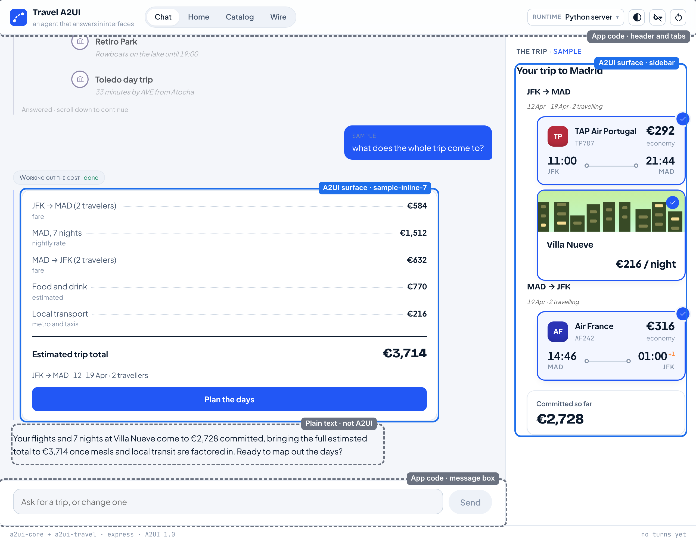
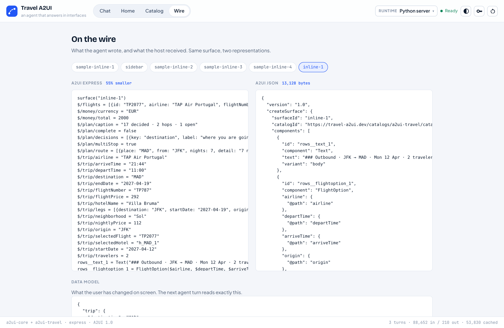

import { LinkCard } from '@astrojs/starlight/components';
import TurnFlow from '../../components/TurnFlow.astro';
import { A2UI, BUILD_YOUR_OWN, QS_REACT } from '../../site';

Read this with the app open, from any of the quickstarts. Every idea here is
something you can see on screen.

## One turn, start to finish

<TurnFlow />

## 1. The core pieces

- **Catalog.** The list of components the agent may use, and what each one
  takes. The **Catalog** tab in the React client draws all of them.
- **Surface.** One region of UI the agent controls, with an id. Each card in
  the conversation is a surface, and so is the trip panel.
- **Component.** One piece of a surface: a `Text`, a `Button`, a
  `FlightOption`. Each has an id and a type from the catalog.
- **Data model.** The data a surface shows. Components point at it by path,
  such as `/flights`, instead of holding the values themselves.
- **Messages.** JSON that creates a surface, changes its components or
  changes its data. This is what travels from the agent to the screen.
- **Action.** What a press sends back. Tap a flight and the agent receives a
  `select_flight` action with that flight's id.
- **Renderer.** The code that turns messages into real widgets: React on the
  web, Flutter on mobile.

### Parent and child components

A surface is not one big nested tree. It is a **flat list of components**, and
a parent names its children by id:

```json
[
  { "id": "root",
    "component": "Column",
    "children": ["title", "fares"] },
  { "id": "title",
    "component": "Text",
    "text": "### Flights to Madrid" },
  { "id": "fares",
    "component": "List",
    "children": {
      "path": "/flights",
      "componentId": "fare" } },
  { "id": "fare",
    "component": "FlightOption",
    "airline": { "@path": "airline" },
    "price": { "@path": "price" } }
]
```

Trimmed: a real `FlightOption` binds a few more properties. The renderer
starts at `root` and follows the ids:

```text
root   Column
├─ title  Text
└─ fares  List over /flights
   └─ fare  FlightOption,
            once per row
```

This shape is what makes it reliable:

- **Nothing deep to get wrong.** Each component is one short entry. A model
  never has to balance ten levels of brackets.
- **It draws while the model is still writing.** A parent can name a child
  that has not arrived yet. The renderer leaves that spot empty and fills it
  in when the child arrives.
- **One piece changes without redrawing the rest.** A message can replace a
  single component by id, or change the data, and only what uses that data is
  redrawn.
- **Structure and data are separate.** The model writes one `FlightOption`
  as a template. The rows come from the flight search, so the price on screen
  is the price the search found, never retyped by the model.
- **Every piece is checked.** Each component is validated against the
  catalog. This app goes further: before anything is sent, the server applies
  it to a copy of what the client holds, and a block that would not fit goes
  back to the model with the reason. The screen never gets a broken card.

## 2. What is A2UI here, and what is app code

Not everything on screen is A2UI. Blue is composed by the agent; grey is the
app's own code, the same on every turn:



- **A2UI, composed by the agent:** the cards in the conversation, the trip
  panel (the trip sheet in Flutter) and the Home tab's dashboard.
- **App code:** the header and tabs, the message box, the chat bubbles (the
  model's words, shown as plain text), the key form, and the Catalog and Wire
  tabs.

The agent decides what goes in the blue parts and nothing else. A rule of
thumb for your own app: if it should look the same on every turn, write it as
app code; if it depends on what the user just asked, let the agent compose it.

### The catalog draws the line

The catalog (`catalogs/a2ui-travel/catalog.json`) is a JSON Schema document
listing every component the agent may use and every property it takes. It
starts from A2UI's **basic catalog** (`Text`, `Row`, `Column`, `List`,
`Button`, `TextField` and more) and adds travel components such as
`FlightOption`, `HotelCard`, `DateRangePicker` and `PriceSummary`.

- The **server** teaches the catalog to the model and checks every message
  against it.
- The **React** and **Flutter** clients implement each component in it.
- All three read the same file, generated by `scripts/build_catalog.py`.

The model can only use what the catalog has. The catalog is the contract
between the agent and every client.

What the model decides and what code decides:

| The model decides | Code decides |
| --- | --- |
| Whether to show a card | Which components exist |
| Which components, and the layout | The data in them: search results, the trip |
| The wording | That every message is valid |
| What to ask next | What a press records on the trip |

## 3. Agent skills

A **skill** is a Markdown file that teaches a model to write A2UI for one
catalog. This app has two, in `skills/express-modular/`:

- `a2ui-core/SKILL.md`: the notation, and the rules that never change.
- `a2ui-travel/SKILL.md`: every component in the catalog, with its properties
  described, so the model knows what it can draw.

Skills are **generated from the catalog, never written by hand**, using the
A2UI agent SDK's `SkillGenerator`:

```text
build_catalog.py → catalog.json
                     │
          A2UI agent SDK processor
            ├─ SkillGenerator → skills/
            ├─ the agent's own prompt
            └─ the parser for its output
```

One configuration (`apps/server/src/travel_a2ui/brain/catalog.py`) produces
all three, so what the model is taught is exactly what it is checked against.
Change a component and run `npm run generate`; CI fails if a skill is stale.

## 4. Agent output and A2UI messages

There are two forms of the same interface.

**Agent output** is what the model writes: **Express**, a short notation (a
DSL), inside `<a2ui>` tags. A flight list:

```text
head = Text("### Flights to Madrid")
fare = FlightOption($airline,
  $departTime, $arriveTime,
  $origin, $destination, $price,
  Event("select_flight", {id: $id}))
list = List(_template($/flights, fare))
root = Column([head, list])
```

**A2UI messages** are the JSON the client receives: `createSurface`,
`updateComponents`, `updateDataModel` and `deleteSurface`.

Between them:

- **On the server,** the A2UI agent SDK's request processor reads the Express
  as the model streams it, turns it into A2UI messages and validates them.
  Messages go out while the model is still writing.
- **In the client,** a **MessageProcessor** from the official SDK applies the
  messages. It keeps each surface's components and data, fills in bound
  values, runs catalog functions such as `formatCurrency`, and sends presses
  back as actions. React uses `@a2ui/web_core`'s (`apps/web/src/surfaces.ts`);
  Flutter uses `a2ui_core`'s (`renderers/flutter/lib/chat.dart`).

The **Wire** tab in the React client shows both forms of every surface side by side:



Express is one way to write A2UI, chosen because it is short. A2UI itself is
the JSON; a model can write that directly.

## 5. Renderers

A **renderer** implements the catalog's components with native widgets and
uses a MessageProcessor to apply messages. It holds no app logic.

- **In this app:** React (`@a2ui/react`, `@a2ui/web_core`) and Flutter
  (`a2ui_flutter`, `a2ui_core`).
- **Maintained by the A2UI project:** Lit (web components), Angular, React,
  Flutter and Markdown.
- **From the community:** SwiftUI and UIKit, Android Compose, React Native,
  Vue, Lynx, a terminal renderer and more.

The server never knows which client it is talking to. Adding a platform means
writing a renderer for the same catalog, with no change to the agent.

<LinkCard title="A2UI renderers" href={A2UI.renderers} />

## Keep going

<LinkCard
  title="Build your own"
  description="What to change to make this app about something other than travel."
  href={BUILD_YOUR_OWN}
/>
<LinkCard title="A2UI documentation" description="Concepts and the v1.0 specification." href={A2UI.home} />
<LinkCard title="Not running yet?" description="Start with Python + React: three commands." href={QS_REACT} />
