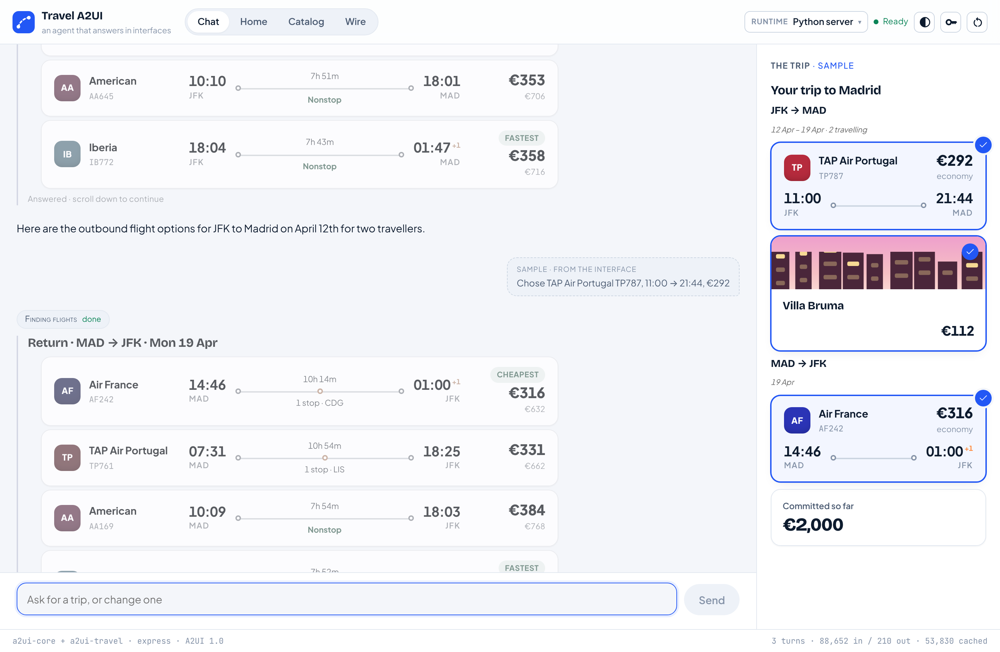
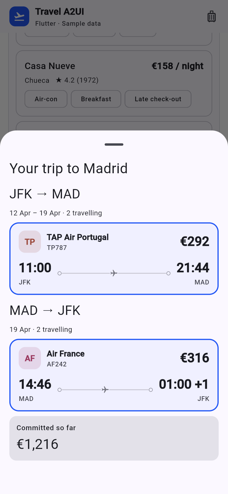
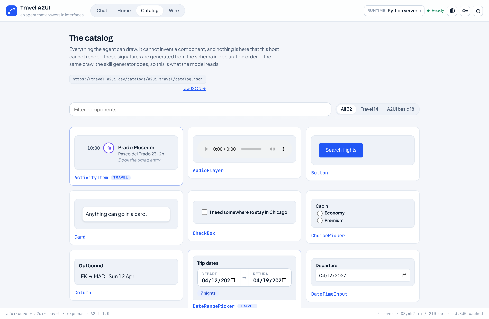
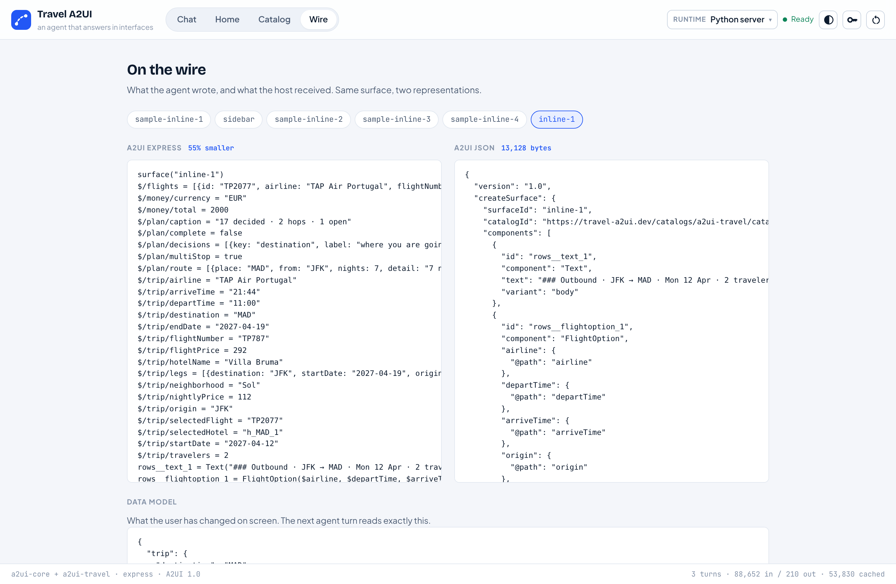
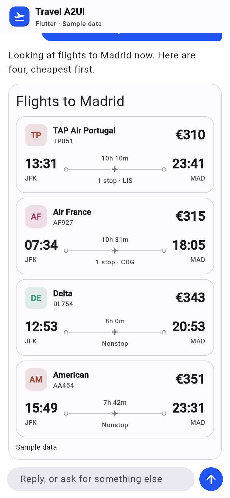

import { Steps, Aside, CardGrid, LinkCard } from '@astrojs/starlight/components';
import AgentPrompt from '../../components/AgentPrompt.astro';
import ArchDiagram from '../../components/ArchDiagram.astro';
import TurnFlow from '../../components/TurnFlow.astro';
import { A2UI, BUILD_YOUR_OWN, FLUTTER_DEMO, PARTNERS } from '../../site';

**A2UI** lets an AI agent answer with an interface instead of a paragraph. In
this quickstart you run **Travel A2UI**, a trip planner whose agent replies
with flight cards, date pickers and a live trip panel. One Python backend
serves the same replies to a React web client and a Flutter mobile client.

Hand the tour to your coding agent, which runs it on your machine and explains
as it goes. Or read it here, on any screen.

<AgentPrompt />

## What you will learn

1. **The core pieces of A2UI**: catalog, surface, components, data model,
   messages, actions, functions and renderer.
2. **What is A2UI and what is deterministic**: what the model decides, and what
   ordinary code decides, including the **catalog** and **macros**.
3. **Agent skills for A2UI**: what they are, and how they are generated from
   the catalog.
4. **Agent output versus A2UI messages**: the **Express** DSL the model writes,
   the JSON messages on the wire, and the **MessageProcessor** that applies them.
5. **Renderers**: the two in this app, and the others A2UI has.

## The architecture

<ArchDiagram />

One Python server serves the API, the React app at `/` and the Flutter app at
`/flutter/`. Neither client contains any travel logic. Each knows how to draw
the catalog's components, and nothing about what a trip is.

<div class="shots">





</div>

<p class="shot-caption">
  The same agent on the web and in a phone layout. In this repository the Flutter client is built
  for the web; the same Dart code can target iOS and Android.
</p>

## Run it

You need `git`, **Node 20+** and **Python 3.11+**.

<Steps>

1. Clone and set up (one to two minutes):

   ```bash
   git clone https://github.com/vpm238/travel-a2ui
   cd travel-a2ui
   npm run setup
   ```

2. Start the server. Set a free Gemini key from
   [AI Studio](https://aistudio.google.com/apikey) to talk to the agent, or
   leave it out:

   ```bash
   source .venv/bin/activate
   export GEMINI_API_KEY=...   # optional
   uvicorn travel_a2ui.doors.http:app --port 8080 --app-dir apps/server/src
   ```

3. Open [http://127.0.0.1:8080](http://127.0.0.1:8080). With no key, you land
   on a recorded sample trip, and the **Catalog** and **Wire** tabs work.

</Steps>

<Aside type="tip" title="No key, or another model platform?">
  The repository has a mock: `GEMINI_API_KEY=scripted python tools/e2e/scripted_server.py 8130`
  runs the real server with a script in place of the model, so you can watch whole turns for
  free. The model is called in one function, `stream_interaction` in
  `apps/server/src/travel_a2ui/gemini.py`, and the mock replaces exactly that. An adapter for
  Claude, OpenAI or a local model replaces it the same way. Your coding agent can walk you
  through it.
</Aside>

## 1. The core pieces of A2UI

Ask the mock for flights and keep only the A2UI messages:

```bash
curl -sN -X POST localhost:8130/api/chat \
  -H 'content-type: application/json' \
  -d '{"message":"flights to Madrid"}' | grep '"type": "ui"'
```

Trimmed, the messages that drew the flight list:

```json
{ "version": "1.0",
  "createSurface": {
    "surfaceId": "inline-1",
    "catalogId": "https://travel-a2ui.dev/catalogs/a2ui-travel/catalog.json",
    "components": [
      { "id": "head", "component": "Text", "text": "### Flights to Madrid" },
      { "id": "row",  "component": "FlightOption",
        "airline": { "@path": "airline" }, "price": { "@path": "price" },
        "action": { "event": { "name": "select_flight",
                               "context": { "id": { "@path": "id" } } } } },
      { "id": "list", "component": "List",
        "children": { "path": "/flights", "componentId": "row" } },
      { "id": "root", "component": "Column", "children": ["head", "list"] }
    ],
    "sendDataModel": true } }

{ "version": "1.0",
  "updateDataModel": { "surfaceId": "inline-1", "path": "/flights",
                       "value": [ { "id": "TP5256", "airline": "TAP Air Portugal", "price": "€310" } ] } }
```

| Piece | What it is | In this app |
| --- | --- | --- |
| **Catalog** | JSON Schema of every component and function the agent may use | `catalogs/a2ui-travel/catalog.json` |
| **Surface** | A region of UI with an id, opened by `createSurface` | each card in the chat; the trip panel |
| **Components** | A flat list of typed nodes with ids; `root` is drawn first | `Text`, `FlightOption`, `List`, `Column` above |
| **Data model** | A JSON document per surface; components bind to it by path | `{"@path": "airline"}`, rows at `/flights` |
| **Messages** | `createSurface`, `updateComponents`, `updateDataModel`, `deleteSurface` | streamed over SSE |
| **Actions** | What a press sends back, with bound values resolved | `select_flight` with the flight's `id` |
| **Functions** | Pure functions the client evaluates against the data model | `formatCurrency`, and the catalog's own `calcNights` |
| **Renderer** | Applies messages and draws components with native widgets | the React and Flutter clients |

The cards are on screen before the search returns: they are bound to
`/flights`, and fill in when the `updateDataModel` lands.

<LinkCard title="Read more: A2UI messages" href={A2UI.messages} />

## 2. What is A2UI, and what is deterministic

The model decides **what to show**. Ordinary code decides **everything that
must not vary**.

**The catalog is the boundary.** The model can only use what the catalog
defines, and every message is validated against it. This catalog extends the
A2UI basic catalog (`Text`, `Row`, `List`, `Button` and so on) with travel
components such as `FlightOption` and `DateRangePicker`. It is generated by
`scripts/build_catalog.py`, and the server, the React client and the Flutter
client all read the same file.



**Macros are deterministic components the model can call.** The model writes
one line, `Flights(...)`, and before anything is sent, the host expands it into
real components bound to the results the search tool returned. It uses the A2UI
SDK's `MacroExpander`, in `apps/server/src/travel_a2ui/brain/macros.py`.

```text
fares = Flights("Outbound · JFK → MAD", "/trip/selectedOutbound")
```

becomes a heading `Text`, a `FlightOption` template, a `List` bound to
`/flights` and the `Column` holding them. The model still decides *whether*,
*when* and *where* to show flights. The macro saves it from re-typing data a
tool just returned: hundreds of output tokens, and a chance to disagree with
what was found. Macros are in the model's skill, but not in `catalog.json`.
Renderers never see one.

| Decided by the model (A2UI) | Decided by code (deterministic) |
| --- | --- |
| Whether to draw, and which components | Which components exist: the catalog |
| Layout, headings and wording | Macro expansion: `brain/macros.py` |
| Which tool to call, with what arguments | What the tool returns: `brain/tools/run.py` |
| What to ask next, guided by `prompts/flow.md` | That a date is asked in a date picker: `brain/controls.py` |
| | Recording a press on the trip: `brain/presses.py` |
| | Presses answered with no model at all: `brain/host_actions.py` |
| | In the client: rendering, data binding and functions |

<p class="shot-caption">Server paths are under <code>apps/server/src/travel_a2ui/</code>.</p>

A rule in a prompt is a request to a model. A rule in code is a guarantee.

<LinkCard title="Read more: catalogs" href={A2UI.catalogs} />

## 3. Agent skills for A2UI

A **skill** is a markdown file that teaches a model to write A2UI for one
catalog. This app has two:

- `skills/express-modular/a2ui-core/SKILL.md`: the **notation**. How to write
  Express, and the rules that never change between catalogs.
- `skills/express-modular/a2ui-travel/SKILL.md`: the **catalog**. Every
  component as a signature with its properties described, plus the macros.

```text
• FlightOption(airline, departTime, arriveTime, origin, destination, price, action (static), duration?, stops?, ...)
  - Description: A single selectable flight itinerary leg. Use one per option when presenting a choice of flights.
  - airline: Operating carrier, e.g. 'Iberia' or 'Delta'.
  - price: Preformatted price including currency, e.g. '$412'.
```

Skills are **generated, never hand-written**, so they cannot drift from the
catalog:

```text
scripts/build_catalog.py → catalog.json → scripts/build_skills.py → skills/*/SKILL.md
                                          (A2UI SDK SkillGenerator: catalog + macros)
```

`npm run generate` runs the pipeline, and `npm run check` fails CI if a skill
is stale. The other half of what the model reads, `prompts/`, is authored:
judgement about what to ask and when.

## 4. Agent output versus A2UI messages

There are two representations of the same interface, and software on each side
of the wire:

<TurnFlow />

- **Agent output is Express**, a compact DSL the model writes:

  ```text
  head = Text("### Flights to Madrid")
  row  = FlightOption($airline, $departTime, $arriveTime, $origin, $destination,
                      $price, Event("select_flight", {id: $id}))
  list = List(_template($/flights, row))
  root = Column([head, list])
  ```

- **The A2UI agent SDK's `ExpressParser` compiles it** on the server into the
  JSON messages above, and validates them against the catalog. A half-written
  program still compiles, so the surface paints while the model is still
  writing.
- **A `MessageProcessor` applies the messages in the client.** It keeps each
  surface's components and data model, resolves bindings, evaluates functions
  and turns presses into actions. React uses `@a2ui/web_core`'s, in
  `apps/web/src/surfaces.ts`. Flutter uses `a2ui_core`'s, in
  `renderers/flutter/lib/chat.dart`.



<p class="shot-caption">
  The Wire tab shows both: what the model wrote, and what the client received.
</p>

Express is one inference format. A2UI does not require it: a model can write
the JSON directly.

<LinkCard title="Read more: the A2UI v1.0 specification" href={A2UI.spec} />

## 5. Renderers

A **renderer** implements the catalog's components with native widgets, and
uses a `MessageProcessor` to apply messages and send actions back.

- **In this app:** React on the web (`@a2ui/react`, `@a2ui/web_core`) and
  Flutter on mobile (`a2ui_flutter`, `a2ui_core`).
- **Maintained by the A2UI project:** Lit (web components), Angular, React,
  Flutter and Markdown.
- **From the community:** SwiftUI and UIKit, Android Compose, React Native,
  Vue, Lynx, a terminal renderer and more.



<p class="shot-caption">
  The Flutter client draws the flights from the same messages as the React one. Try it on the <a href={FLUTTER_DEMO}>hosted demo</a>.
</p>

<LinkCard title="A2UI renderers" href={A2UI.renderers} />

## Keep going

You have now seen A2UI from the inside. Next, see what teams have built with
it, and how they fitted it into an existing product.

<CardGrid>
  <LinkCard
    title="Partner and consultant demos"
    description="A2UI in production apps, and how teams brought it into their own stack."
    href={PARTNERS}
  />
  <LinkCard
    title="Build your own"
    description="What to change to make this app about something other than travel."
    href={BUILD_YOUR_OWN}
  />
  <LinkCard
    title="A2UI documentation"
    description="Concepts, the v1.0 specification and the renderer SDKs."
    href={A2UI.home}
  />
</CardGrid>
