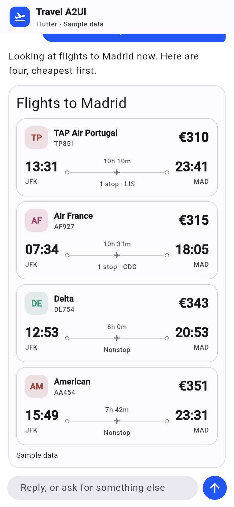

import { Steps, LinkCard } from '@astrojs/starlight/components';
import { CONCEPTS } from '../../../site';

You need **Python 3.11+**, **Node 20+** and **Flutter 3.47+**.

<Steps>

1. Get the code and start it:

   ```bash
   git clone https://github.com/vpm238/travel-a2ui
   cd travel-a2ui
   ./scripts/quickstart.sh both
   ```

   The script installs the server into `.venv`, builds both clients and starts
   the server. Leave it running.

2. Open both, side by side:
   - React: [http://127.0.0.1:8080](http://127.0.0.1:8080)
   - Flutter: [http://127.0.0.1:8080/flutter/](http://127.0.0.1:8080/flutter/)

3. Paste a free Gemini key from [AI Studio](https://aistudio.google.com/apikey)
   into each when it asks, or start the script with `GEMINI_API_KEY` set.

</Steps>

## Try it

Ask both the same thing, say *"Flights from JFK to Madrid on 12 April, two of
us"*. The answers are the same kind of A2UI messages from the same server,
drawn once by React and once by Flutter, each with its own widgets.



Nothing in the server knows which client it is talking to. That is the point
of A2UI: the agent describes an interface, and each platform draws it.

## What is running

- **The server** (`apps/server/`): the agent, and the A2UI agent SDK that
  turns what the model writes into checked A2UI messages.
- **React** (`apps/web/`, `renderers/react/`): `@a2ui/react` and
  `@a2ui/web_core`.
- **Flutter** (`renderers/flutter/`): `a2ui_flutter` and `a2ui_core`.

<LinkCard
  title="Next: How A2UI works"
  description="What you are looking at, explained with the app open."
  href={CONCEPTS}
/>
