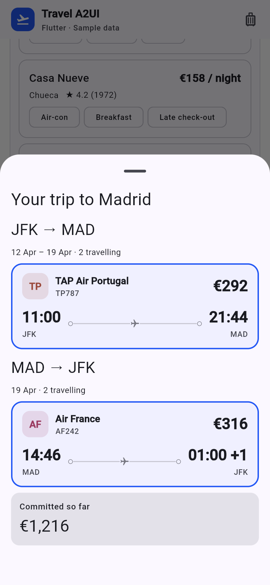

import { Steps, LinkCard } from '@astrojs/starlight/components';
import { CONCEPTS, FLUTTER_DEMO } from '../../../site';

You need **Python 3.11+** and **Flutter 3.47+**. Node is not needed.

<Steps>

1. Get the code and start it:

   ```bash
   git clone https://github.com/vpm238/travel-a2ui
   cd travel-a2ui
   ./scripts/quickstart.sh flutter
   ```

   The script installs the server into `.venv`, builds the Flutter client
   (about a minute) and starts the server. Leave it running.

2. Open [http://127.0.0.1:8080/flutter/](http://127.0.0.1:8080/flutter/).

3. Paste a free Gemini key from [AI Studio](https://aistudio.google.com/apikey)
   when it asks. It stays in your browser. (Or start the script with
   `GEMINI_API_KEY` set, and it won't ask.)

</Steps>



## Try it

Ask *"A weekend in Lisbon from JFK in May, two of us"*. The agent answers with
cards it composes for that question, for example the dates to confirm and then
flights to pick, and the trip sheet at the bottom fills in as you choose.

No Flutter on this machine? Try the <a href={FLUTTER_DEMO}>hosted one</a>.

## What is running

- **The server** (`apps/server/`): the agent. It talks to Gemini and uses the
  A2UI agent SDK to turn what the model writes into checked A2UI messages.
- **The Flutter client** (`renderers/flutter/`): draws those messages with the
  official `a2ui_flutter` and `a2ui_core`. The travel components are in
  `renderers/flutter/lib/components.dart`.

Here Flutter is built for the web and drawn in a phone layout. The same Dart
code can target iOS and Android, which this repository does not set up.

<LinkCard
  title="Next: How A2UI works"
  description="What you are looking at, explained with the app open."
  href={CONCEPTS}
/>
