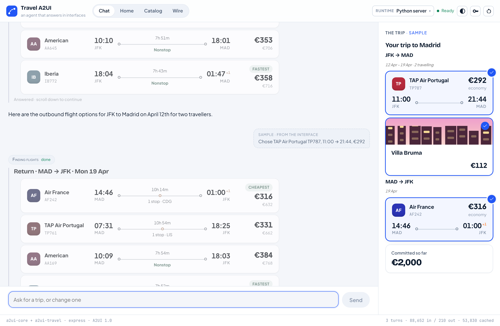

import { Steps, LinkCard } from '@astrojs/starlight/components';
import { CONCEPTS } from '../../../site';

You need **Python 3.11+** and **Node 20+**.

<Steps>

1. Get the code and start it:

   ```bash
   git clone https://github.com/vpm238/travel-a2ui
   cd travel-a2ui
   ./scripts/quickstart.sh react
   ```

   The script installs the server into `.venv`, builds the React client and
   starts the server. Leave it running.

2. Open [http://127.0.0.1:8080](http://127.0.0.1:8080).

</Steps>



## Try it

- **No key needed:** you land on a recorded sample trip. The **Catalog** tab
  draws every component the agent may use; the **Wire** tab shows what the
  model wrote beside the A2UI messages the client received.
- **To talk to the agent:** paste a free Gemini key from
  [AI Studio](https://aistudio.google.com/apikey) when the app asks (it stays
  in your browser), or start the script with `GEMINI_API_KEY` set. Then try
  *"Six days in Madrid in April, two of us, around $2,500 all in"*.

## What is running

- **The server** (`apps/server/`): the agent. It talks to Gemini and uses the
  A2UI agent SDK to turn what the model writes into checked A2UI messages.
- **The React client** (`apps/web/`): draws those messages with the official
  `@a2ui/react` and `@a2ui/web_core`. The travel components are in
  `renderers/react/src/components/travel.tsx`.

To edit the client with hot reload, run `npm run dev:web` in a second terminal
and open [http://localhost:5173](http://localhost:5173). It uses the same
server.

<LinkCard
  title="Next: How A2UI works"
  description="What you are looking at, explained with the app open."
  href={CONCEPTS}
/>
